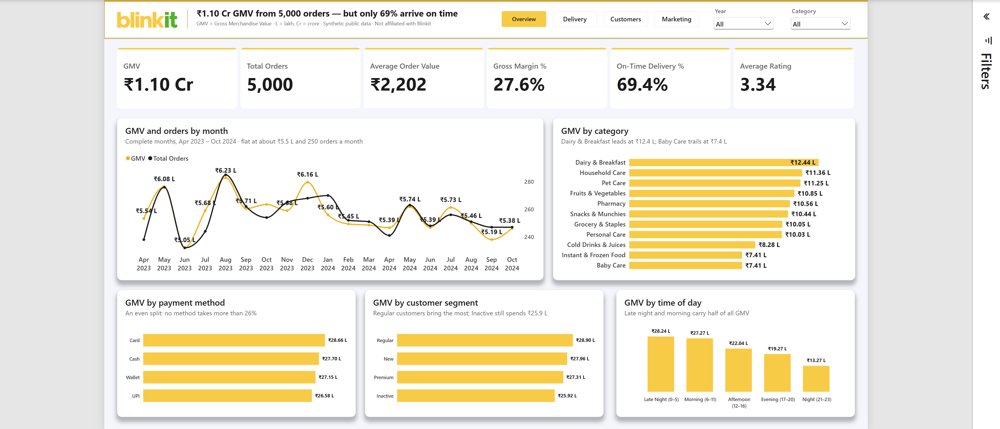

# Jhala AI: chat with a Blinkit Power BI dashboard

**Built by Harpal Sinh Jhala** · Power BI · DAX · MCP · Python · LLM tool calling

**Live demo:** https://blinkit-ai-analyst.onrender.com

A web page with my **Blinkit Pulse** Power BI dashboard on the left and **Jhala AI**, my analytics chatbot, on the right.
Ask "Chart: GMV by category, highest first" or "On-time delivery % by time of day". Jhala AI answers from the same
semantic model as the dashboard, through my own **MCP server**, so every number comes from validated Power BI measures
(₹ lakh / crore formatting included), not from the LLM's memory.

> Free hosting: if nobody has opened the link for 15 minutes, the first load takes about 50 seconds while the server wakes up.



## What it does
- **Dashboard:** the published 4-page Power BI report (Overview, Delivery, Customers, Marketing), embedded with a
  view-only token, so visitors don't sign in.
- **Chat:** questions in plain English → the LLM picks measures and fields from a menu → the MCP server writes the
  DAX and runs it on the published model → answer, table or chart (Plotly).
- **Accuracy guardrails:** 43 curated measures and 23 fields (`rules/blinkit.yaml`); the server works out highest /
  lowest itself, so the AI never compares numbers by eye; warnings when a field isn't linked to a measure
  (e.g. marketing spend by product category); free-form DAX is a flagged fallback only.
- **Transparency:** every answer has a "How I got this" panel listing the exact MCP queries.
- **Resilient on free tiers:** if the main Groq model's daily quota runs out, it switches to a fallback model.

Sample answers (checked against the dashboard): GMV ₹1.10 Cr from 5,000 orders · on-time delivery 69.4% ·
Dairy & Breakfast is the top category at ₹12.44 L · Email is the best channel at 2.05x ROAS.

## How it works
```
Browser ──► app.py (FastAPI) ──► LLM on Groq (tool calling)
                 │                    │ picks a tool + arguments
                 └──── MCP client ◄───┘
                        │ stdio
                  mcp_server.py ──► DAX ──► Power BI semantic model "Blinkit Pulse"
                        ▲                     (service principal, executeQueries API)
                  rules/blinkit.yaml
```

| File | What it does |
|---|---|
| `app.py` | Web server: serves the page, runs the chat loop with the LLM, and talks to the MCP server as an MCP client |
| `mcp_server.py` | MCP server: tools `describe_model`, `list_values`, `get_measures`, fallbacks `describe_table`, `run_dax`; prompt `analyst_instructions`; resource `model://ui` |
| `model_profile.py` | Reads the model's measures and fields and merges the rules file (works with any Power BI model) |
| `rules/blinkit.yaml` | Jhala AI's menu for Blinkit Pulse: measures, formats, fields, warnings, suggested questions |
| `pbi_client.py` | Power BI sign-in (service principal / browser / device code), embed tokens and DAX queries |
| `web/index.html` | The page: embedded dashboard, Jhala AI chat, charts; tabs on mobile |
| `powerbi/` | The Blinkit Pulse Power BI project (PBIP: TMDL model + PBIR report), reading the public CSVs from GitHub |
| `scripts/publish_to_powerbi.py` | Publishes `powerbi/` to the workspace via the Fabric REST API, sets the data source and refreshes |
| `render.yaml` | Render hosting (free web service, redeploys on every push to `main`) |

## The data
Public, synthetic Blinkit sample data (Kaggle): 5,000 orders, Mar 2023 – Nov 2024. Cleaning, star schema, measures
and validation are documented in my [blinkit-pulse-analytics](https://github.com/harpalsinhjhala/blinkit-pulse-analytics)
repo; the model reads its clean CSVs straight from GitHub, so Power BI Service refreshes without a gateway.

> Independent portfolio project. Not affiliated with or endorsed by Blinkit; the name and logo belong to their owner.

## Run it yourself
```bash
python -m venv .venv
.venv/Scripts/python -m pip install -r requirements.txt
copy .env.example .env                                  # fill in the values
.venv/Scripts/python scripts/publish_to_powerbi.py      # once: publishes the model + report, prints the IDs
.venv/Scripts/python app.py                             # open http://localhost:8000
```
Needs a Power BI workspace with an Entra ID app (service principal) as Member, the tenant setting
**Service principals can call Fabric public APIs** enabled, and a free Groq API key.

## Deploy (Render)
[](https://render.com/deploy?repo=https://github.com/harpalsinhjhala/blinkit-ai-analyst)

Set the two secrets, `GROQ_API_KEY` and `AZURE_CLIENT_SECRET`, when Render asks. Every `git push` to `main` redeploys.

---
Made by **Harpal Sinh Jhala**, data analyst and Power BI developer.
